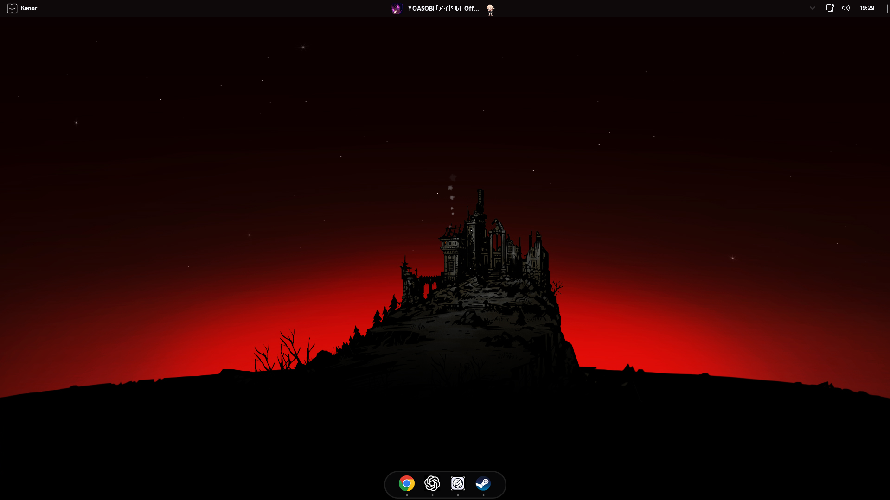
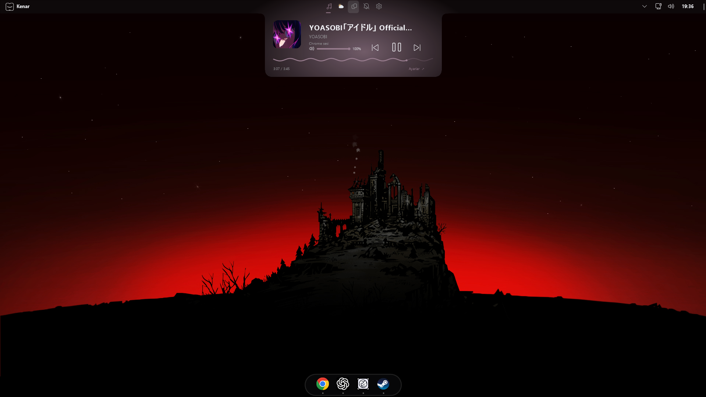
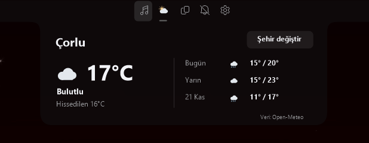
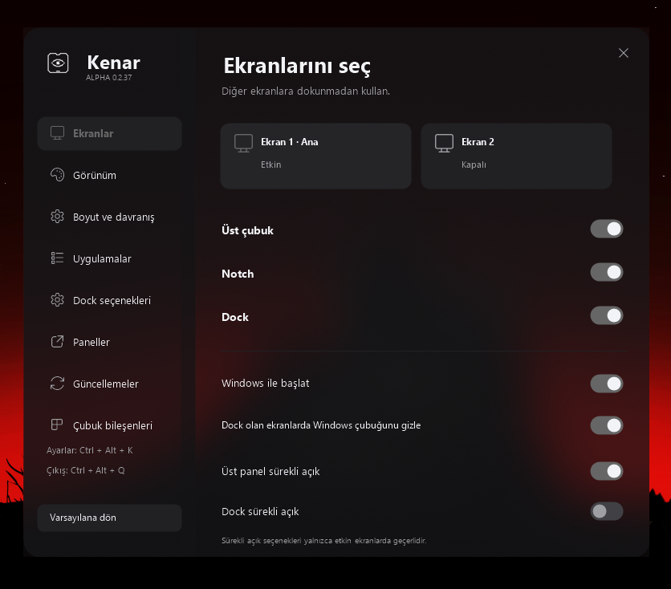

# Kenar

Kenar is a native Windows desktop companion built in Rust. It adds a configurable top bar, an expandable media notch, and an auto-hiding app dock.

**[Download Kenar for Windows x64](https://github.com/Farketmezzz/kenar-releases/releases/latest/download/Kenar-win-x64-Setup.exe)** · [Release notes](https://github.com/Farketmezzz/kenar-releases/releases)

## What Kenar does

- **Top bar** — Open Kenar’s Start menu, system tray, and audio mixer from the top of your screen.
- **Media notch** — Hover over the center of the top bar to see the artwork and playback controls for the active Windows media session.
- **App dock** — Pin apps by dragging shortcuts onto the dock, switch to running apps, and hover over an icon to preview its open windows.
- **Per-monitor settings** — Enable the top bar, notch, and dock on the displays you choose. Adjust their size, position, or visibility and choose between solid and glass effects.

## Screenshots

These screenshots show a development build. Weather, clipboard history, and the animated GIF indicator are previews of features newer than the current public installer. The in-notch notification panel is also in development for public releases.

### Expanded notch and dock

### Media controls

The expanded notch shows artwork, playback progress, transport controls, and a volume slider for the active media source.

### Weather

Choose a city to see current conditions and a short forecast from Open-Meteo.

### Display settings

Choose which screens use Kenar and toggle each component independently.

## Install and update

1. Download and run [`Kenar-win-x64-Setup.exe`](https://github.com/Farketmezzz/kenar-releases/releases/latest/download/Kenar-win-x64-Setup.exe).
2. Press **Ctrl + Alt + K** to open Settings. To check for a new version, go to **Settings → Updates** (`Ayarlar → Güncellemeler`).

If Kenar is already running when you launch the installer, press **Ctrl + Alt + Q** to quit it first.

Kenar uses the `.nupkg` and `releases.win-x64.json` files for in-app updates.

Found a bug? [Open an issue](https://github.com/Farketmezzz/kenar-releases/issues/new) and include your Kenar version and Windows version.
